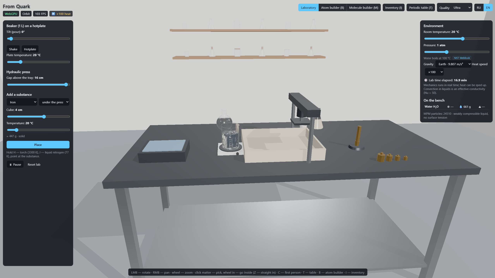
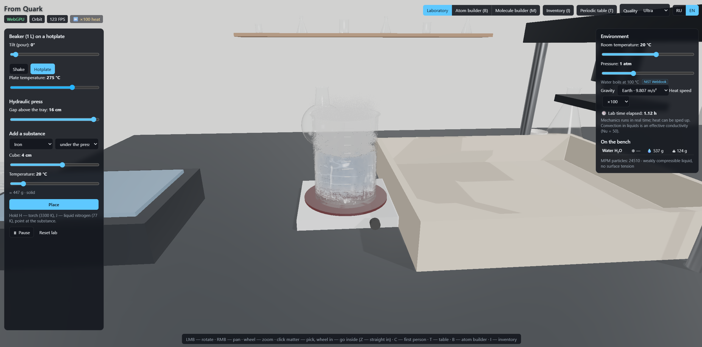
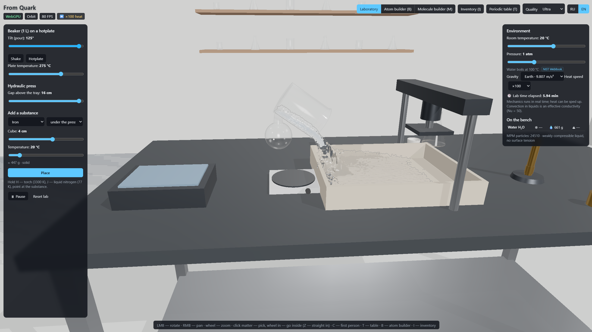

# From Quark

3D sandbox of matter: from protons to substances. TypeScript + Vite + Three.js (WebGPU, WebGL2 fallback) + React.

**DE:** 3D-Physik-Sandbox im Browser: ein Labor mit Wassersimulation auf der GPU (MLS-MPM, ~24 000 Partikel), Wärme und
Phasenübergängen, Atom- und Molekülbaukasten und einem stufenlosen Zoom vom Becherglas bis zum Quark. Alle Stoffwerte mit
Quellenangabe (IUPAC, NIST, CRC Handbook).



| Boiling on the hotplate | Pouring into the tray |
|---|---|
|  |  |

```bash
npm install
npm run dev        # http://localhost:5173
npm test           # science unit tests
npm run build
```

Keys: `B` atom builder, `M` molecule builder, `T` periodic table, `I` inventory, `C` orbit/first person in the lab,
hold `H` (torch) / `J` (liquid nitrogen) to heat or cool what is under the cursor.
Click matter in the lab to pick it and wheel in: at 4 cm the view hands over to a continuous zoom
(grains → atoms/molecules → electron cloud → nucleus → proton → quark; wheel all the way out returns to the lab).
`Z` jumps straight in. The zoom has a labelled "textbook" look and a "microscope" (electron density) look.

## Layout

| Folder | What |
|---|---|
| `src/data/` | Elements, isotopes (generated JSON), molecules, substances, data sources |
| `src/chem/` | Formulas, molar mass, electron configurations, SMILES, valence, bond types, VSEPR, 3D geometry |
| `src/nuclear/` | Nucleus status, decay modes and branching (NUBASE codes), decay timing |
| `src/sim/` | MLS-MPM on WebGPU compute (`mpm/`), thermodynamics (`thermo.ts`), lab vessels and colliders |
| `src/render/` | Macro lab scene, particle rendering, blackbody glow, micro views (atom, molecule) |
| `src/game/` | Engine, fixed-step loop, camera rig, quality presets, builders, lab simulation, inventory |
| `src/ui/` | React overlay, zustand stores |
| `src/i18n/` | RU/EN strings |
| `scripts/data/` | `data:fetch` downloads raw data into `data-raw/`, `data:build` turns it into `src/data/*.json` |

## Simulation model (honest limits)

- **Liquids:** weakly compressible MLS-MPM (Tait EOS). An artificial sound speed of 6 m/s keeps the step size practical;
  density stays within a few percent of the real value. No surface tension.
- **Solids:** Neo-Hookean with J2 plasticity. Stiffness and yield are scaled to the same sound speed, so deformation
  shapes are qualitative and forces are not real.
- **Heat:** grid conduction, latent heat via enthalpy, convection to air and radiation, a hotplate and a heat brush.
  Natural convection in liquids is modelled as an effective conductivity (Nu = 50); a Boussinesq force adds visible flow.
  Heat can run up to ×1000 faster than the mechanics.
- **Phases:** melting points don't depend on pressure. Boiling points do: Antoine within NIST ranges, Clausius–Clapeyron
  elsewhere. Water's density maximum at 4 °C is not modelled. Fully boiled liquid becomes short-lived steam puffs.
- **Determinism:** grid sums use fixed-point integer atomics, so a run doesn't depend on GPU thread order.
- **Zoom:** grain sizes are typical values, not computed. The molecular cell is a periodic box tiled to fill the view
  (real lattices for ice Ih, BCC/FCC metals and NaCl; Lennard-Jones liquids without charges; ideal gas). Molecules come
  from each substance's SMILES. Orbitals are hydrogen-like with Slater Z_eff; the nucleus layout and quark motion are
  schematic. Quarks are drawn as points: no structure is known down to ~10⁻¹⁹ m.

## Data sources

| Data | Source |
|---|---|
| Standard atomic weights | IUPAC CIAAW, Abridged Standard Atomic Weights 2024 |
| Electron configuration, electronegativity, ionization energy, electron affinity, vdW radius, oxidation states, CPK colours | PubChem Periodic Table (NCBI) |
| Isotopes: mass excess, half-life, decay modes and branchings, natural abundance | NUBASE2020: Kondev et al., Chin. Phys. C 45, 030001 (2021) |
| Covalent radii (single/double/triple) | Pyykkö et al. 2005, 2009 (via the `mendeleev` package database) |
| Molecular geometries | NIST CCCBDB experimental values (where listed), otherwise Pyykkö radii + ideal VSEPR angles |
| Substance properties (Tm, Tb, densities, heat capacities, latent heats, conductivities) | CRC Handbook 97th ed.; NIST WebBook (Antoine, Tb); IAPWS (water triple/critical points); Assael et al. 2006 (liquid iron) |
| Surface gravity | NASA Planetary Fact Sheet |

Values without a reliable reference are marked `оценка` (estimate) in `src/data/substances.ts` and in the inspector.
Each value in the inspector shows its source tag; hover it for the full citation.
